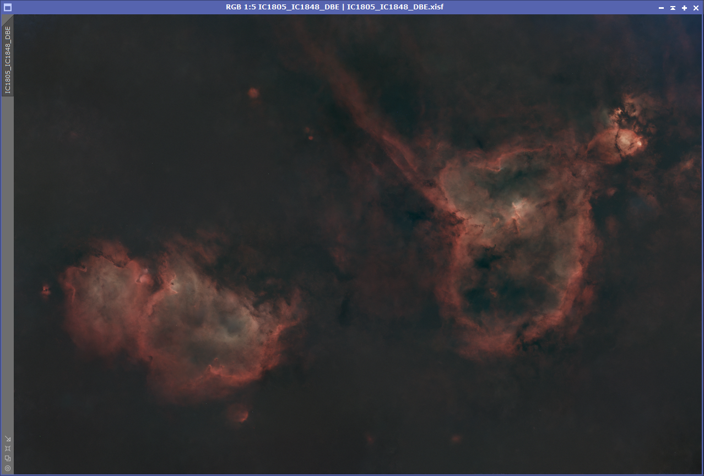
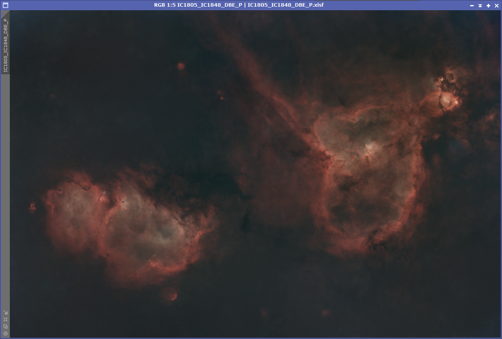
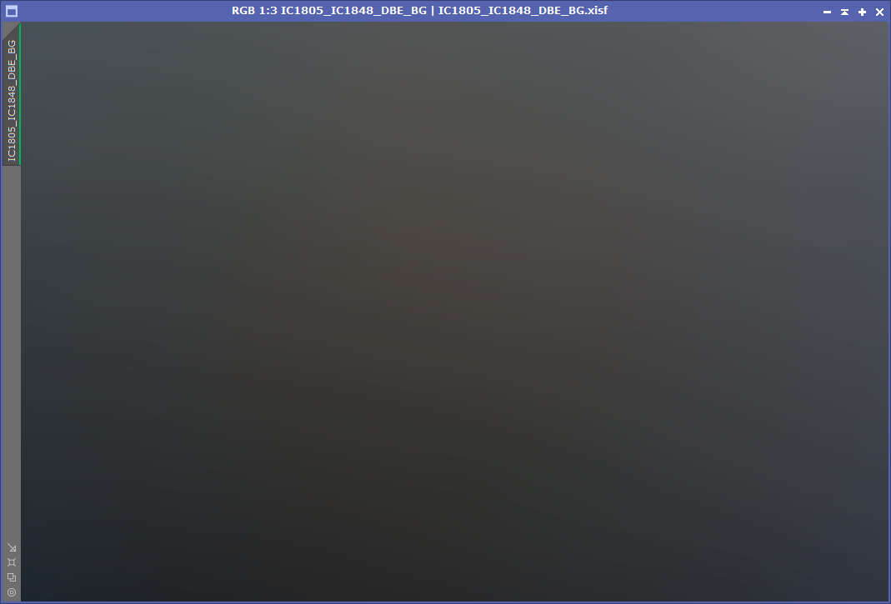
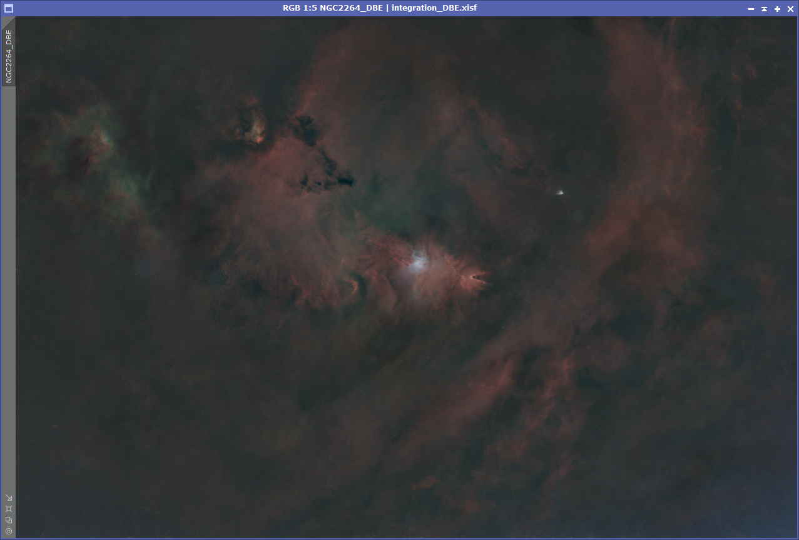
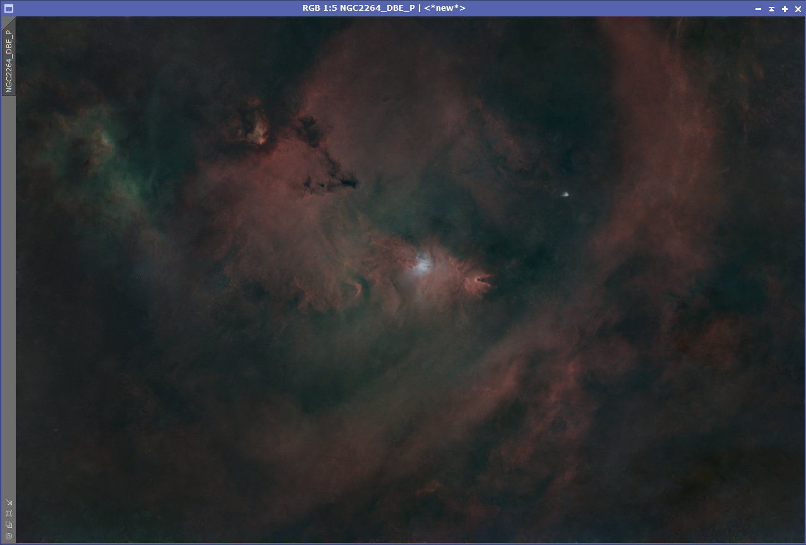
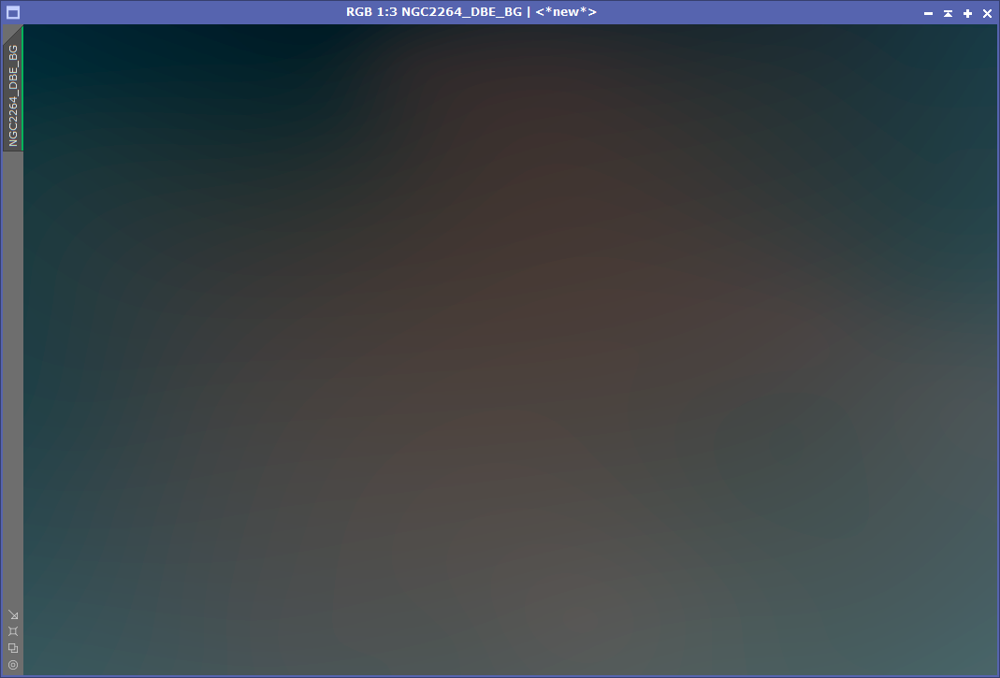
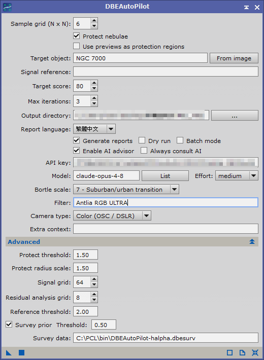

# DBEAutoPilot — 一鍵完成 DBE 背景扣除的 PixInsight 模組 / One-click DBE background modelization for PixInsight

> **讓城市深空攝影後製更簡單**
> *Deep-sky post-processing under city skies, made simple.*

**語言 / Language**：[繁體中文](#zh) ｜ [English](#en)

---

<a id="zh"></a>

# 繁體中文

DBEAutoPilot 是 PixInsight 原生 C++ Process 模組，把 DynamicBackgroundExtraction（DBE）
最花時間的部分自動化：**自動佈點（絕不放在星雲上）→ 執行 DBE → 客觀評分 →
〔可選〕AI 顧問迭代 → smoothing 掃描擇優 → 產出結果視窗與雙語報告**。

- **原圖零更動**：全程在複製視窗上運算，產出 `<原圖>_DBE`（校正結果）與
  `<原圖>_background`（背景模型）兩個新視窗。
- **星雲保護**：五道防線確保取樣點不落在瀰漫雲氣上，另有獨立偵測器監控
  「背景模型是否偷偷跟著星雲起伏」。
- **AI 可選、可降級**：不設定 API key 一樣完整可用；AI 任何失敗都自動退回確定性流程。

## 目錄

1. [成果對比（手動 DBE vs DBEAutoPilot）](#成果對比手動-dbe-vs-dbeautopilot)
2. [安裝方式](#安裝方式)
3. [主要功能（介面逐項說明）](#主要功能介面逐項說明)
4. [演算法邏輯與公式](#演算法邏輯與公式)
5. [評分標準](#評分標準)
6. [授權](#授權)

## 成果對比（手動 DBE vs DBEAutoPilot）

命名規則：`XXX_DBE` = **手動 DBE** 的結果；`XXX_DBE_P` = **DBEAutoPilot** 的結果；
`XXX_DBE_BG` = 工具分析後分離出的**背景模型**。看兩件事：星雲的亮度與對比有沒有被保留、
背景模型是不是「不帶星雲形狀」的平滑漸層（若背景模型長得像星雲，代表真實訊號被當背景扣掉了）。

> **對比條件**：兩張成果圖**只有**背景扣除這一步用的工具不同（手動 DBE vs DBEAutoPilot），
> 其餘後製流程與參數完全一樣——ImageSolver → SPCC → HistogramTransformation →
> StarNet2 → NoiseXTerminator 全部用相同設定，所以差異只來自背景扣除本身。

### IC1805 / IC1848（心臟與靈魂星雲）

手動 DBE（`_DBE`）：



DBEAutoPilot（`_DBE_P`）：



工具分離出的背景模型（`_DBE_BG`）——平滑漸層、不帶雲氣形狀：



### NGC 2264（錐狀星雲 / 聖誕樹星團）

手動 DBE（`_DBE`）：



DBEAutoPilot（`_DBE_P`）：



工具分離出的背景模型（`_DBE_BG`）：



### 報告範例（HTML）

每次執行都會產出一份 HTML 報告：評分明細、每道保護的實際生效狀況、掃描歷程、
以及四張內嵌縮圖。以下是兩種模式的實際範例——

| 模式 | 線上預覽 | 下載檔案 |
|---|---|---|
| **未啟用 AI**（純確定性管線） | [線上預覽](https://htmlpreview.github.io/?https://github.com/Conan0312/DBEAutoPilot/blob/main/docs/Result_Report.html) | [Result_Report.html](docs/Result_Report.html) |
| **啟用 AI 顧問** | [線上預覽](https://htmlpreview.github.io/?https://github.com/Conan0312/DBEAutoPilot/blob/main/docs/Result_Report_AI.html) | [Result_Report_AI.html](docs/Result_Report_AI.html) |

> GitHub 不會直接渲染 repo 內的 HTML，點檔案只會看到原始碼。請用左欄的「線上預覽」
> （透過 htmlpreview.github.io 渲染），或直接下載右欄檔案以瀏覽器開啟。
> 兩份報告的差異就是「AI 顧問」章節——啟用 AI 版多了 AI 總評、問題清單、
> 參數調整明細與 API 用量費用。

## 安裝方式

**需求**：PixInsight 1.8.9 以上（建議 1.9.3+）、Windows 64-bit。

從 Releases 下載 `DBEAutoPilot-<版本>-manual-install-win-x64.zip`，解壓後內容：

```
DBEAutoPilot-pxm.dll     模組本體（Windows x64）
icons/DBEAutoPilot.svg   工具圖示
sign-module.js           自簽章腳本（步驟 3 使用）
README.txt               安裝說明（與本節相同）
```

### 步驟 1 — 複製檔案

1. 把 `DBEAutoPilot-pxm.dll` 複製到 PixInsight 的 bin 資料夾：
   `C:\Program Files\PixInsight\bin\`
2. 把 `icons\DBEAutoPilot.svg` 複製到（資料夾不存在就自己建立）：
   `C:\Program Files\PixInsight\rsc\icons\module\DBEAutoPilot\`
   （沒複製圖示模組仍可運作，只是圖示空白。寫入 Program Files 需要系統管理員權限。）

### 步驟 2 — 嘗試直接安裝

1. 開啟 PixInsight → 選單 **PROCESS → Modules → Install Modules...**
2. 按 **Search**，或手動指到 bin 資料夾選 `DBEAutoPilot-pxm.dll` → **Install**。
3. **完整重新啟動** PixInsight（核心只在啟動時載入模組）。
   成功後模組出現在 **Process Explorer → BackgroundModelization → DBEAutoPilot**。

安裝時若出現「模組未簽章 / signature」相關錯誤而無法安裝，繼續步驟 3。

### 步驟 3 — 產生你自己的模組簽章（自簽）

PixInsight 的模組簽章（`.xsgn`）綁定**簽章者本人的授權與機器**——開發者的簽章在你的
電腦上無效，所以壓縮包刻意不附 `.xsgn`，改附自簽腳本，用你自己的授權重簽一次：

1. 開啟 PixInsight → 選單 **SCRIPT → Execute Script File...**
2. 選擇壓縮包內的 `sign-module.js`。
3. 出現檔案選擇視窗後，選你在步驟 1 複製到 bin 的 `DBEAutoPilot-pxm.dll`。
4. Console 出現 **SUCCESS** 即完成——DLL 旁會多出 `DBEAutoPilot-pxm.xsgn`。
5. 回到步驟 2 重新安裝，並重新啟動 PixInsight。

**說明**：

- 第一次執行會在 DLL 旁建立 `local-signing-keys.xssk`（你的本機簽章金鑰）。
  金鑰密碼預設寫在 `sign-module.js` 開頭的 `KEYS_PWD`，想改請在**第一次執行前**改。
- 之後每次收到新版 DLL，把 DLL 覆蓋進 bin、**重跑一次 sign-module.js** 即可。
- 若檔案選擇視窗在你的版本上打不開，改在 `sign-module.js` 開頭的
  `DLL_PATH_OVERRIDE` 直接填入 DLL 路徑（用正斜線）。
- 腳本只會讀取 DLL、寫出 `.xsgn` / `.xssk` / `.log` 三種檔案，
  不會動到你的影像或 PixInsight 安裝。

### 疑難排解

| 症狀 | 處置 |
|---|---|
| 安裝後 Process Explorer 找不到模組 | 確認有「完整關閉再重開」PixInsight |
| sign-module.js 沒出現 SUCCESS | 把 Console 完整輸出與 bin 內 `sign-module.log`（若有）回報給開發者 |
| 其他問題 | 附上 PixInsight 版本（Help → About）、Windows 版本與安裝時 Console 的完整訊息 |

**可選功能的額外準備**：

| 功能 | 需要什麼 |
|---|---|
| 星表天體圓保護（Target object） | 影像有天測解（先跑 ImageSolver） |
| 全天巡天先驗（Survey prior） | 天測解 + 一個 `.dbesurv` 資料檔（以隨附的 `make_survey.py` 從公開巡天 FITS 轉檔一次，之後離線使用） |
| AI 顧問 | [console.anthropic.com](https://console.anthropic.com) 的 API key（每輪一次付費呼叫；模組已達標時預設自動跳過以省費用） |

**基本用法**：開啟 linear 疊圖 → 開啟 DBEAutoPilot → 確認 Target object（有星雲時填）→
按左下角 Apply（方形）。跑完看 Console 摘要與輸出目錄裡的 HTML 報告。

## 主要功能（介面逐項說明）



### 主畫面

| 控制項 | 用途 | 使用方法 |
|---|---|---|
| **Sample grid (N x N)** | 內部取樣格點的密度（圖中 6 = 內部 36 點），模組會再自動加上貼邊一圈取樣點 | 一般 5–7 即可；梯度複雜的影像可加大 |
| **Protect nebulae** | 星雲保護總開關 | 保持勾選。這是本模組與手動 DBE 最大的差異：取樣點永遠不落在偵測到的雲氣上 |
| **Use previews as protection regions** | 把你在影像上**畫好的 preview 框**當作「禁止佈點區」 | 先用 New Preview（Alt+N）把雲氣框起來，再勾選、執行。這是最直接的保護方式：不需要星表、不需要天測解 |
| **Target object** | 要保護的天體編號（可多個，逗號分隔，如 `IC1805,IC1848`）。模組用影像的天測解把星表上該天體的範圍投影成保護圓 | 支援 IC/NGC/M/Sh2/LBN/vdB/Ced 編號與常見俗名。留空時退回 FITS 的 `OBJECT` keyword。**星表只收瀰漫星雲**——拍星系（如 M81）不用填，此時相關檢查會顯示「棄權」，那是正確狀態 |
| **From image** | 從目前影像重讀 `OBJECT`、`FILTER` 與相機類型填入欄位 | 換影像後按一下 |
| **Signal reference** | 進階保護：填一個「知道星雲在哪」的 view 的名字——手工做的星雲遮罩，或同目標的 Hα 疊圖 | 必須與目標同尺寸、linear；不能填目標影像自己 |
| **Target score** | 目標分數（0–100 的客觀評分），達標即停 | 預設 80 |
| **Max iterations** | AI 迭代上限 | 預設 3 |
| **Output directory** | 報告輸出位置 | 用 `...` 選取 |
| **Report language** | 報告語言（繁體中文 / English） | — |
| **Generate reports** | 產出 TXT + HTML 報告：評分明細、每道保護的實際生效狀況、四張縮圖（佈點圖／校正前後／背景模型） | 建議開啟；出問題時報告是最好的除錯依據 |
| **Dry run** | 只診斷不執行：看評分、看佈點、（有 AI 時）看建議，不產生結果視窗 | 第一次跑新目標可先 Dry run |
| **Batch mode** | 批次處理所有開啟的影像 | 勾選後改按 Apply Global（圓形按鈕） |
| **Enable AI advisor** | 讓 Claude 讀診斷數據、建議取樣點調整與 DBE 參數，套用後自動驗證迭代 | 需 API key。所有 AI 建議都會先經過合法性檢查與星雲遮罩過濾 |
| **Always consult AI** | 分數已達標仍呼叫 AI | 預設關閉（省費用）；想要報告裡的 AI 文字總評再開 |
| **API key / Model / List / Effort** | API 金鑰、使用的模型、`List` 列出帳號可用模型、推理力度 | 金鑰只存在本機 PixInsight 設定中。想省費用：Model 選 sonnet 級、Effort 調 low |
| **Bortle scale / Filter / Camera type / Extra context** | 拍攝環境資訊，**只給 AI 當背景知識**（不影響任何計算） | Camera type 會從影像自動判定；Extra context 可寫任何想告訴 AI 的事（如「當晚西側有城市光害」） |

### Advanced（進階，預設收合——預設值適用於多數影像）

| 控制項 | 用途 | 什麼時候動它 |
|---|---|---|
| **Protect threshold** | 影像自動偵測星雲的靈敏度（越小越積極），預設 1.50 | 雲氣沒被保護到→調小；背景被過度保護→在**已填 Target object** 的前提下調大 |
| **Protect radius scale** | 星表保護圓的放大倍率，預設 1.50 | 星雲外圍翼仍被取樣→逐步調大（面積隨平方成長） |
| **Signal grid** | 星雲偵測的網格解析度，預設 64 | 一般不動 |
| **Residual analysis grid** | 殘差診斷網格，預設 8 | 一般不動 |
| **Reference threshold** | Signal reference 的偵測靈敏度，預設 2.00 | 用 Hα 參考時視其對比調整 |
| **Survey prior / Threshold / Survey data** | 用全天 Hα 巡天圖標記「其他望遠鏡知道這裡有發射」的區域，預設開啟但需要資料檔才生效 | 轉好 `.dbesurv` 後把路徑填入 Survey data 一次即可（會記住）。沒有檔案時只會印一行提示、不影響其他功能 |

## 演算法邏輯與公式

**流程**：星雲保護遮罩 → 抗污染佈點 → 初始 DBE（於複製品）→ 殘差診斷 + 評分 →
〔AI 迭代〕→ smoothing 掃描（0.25 / 0.10 / 0.15 / 0.35 / 0.50 逐一試跑、保留最高分）→
結果視窗 + 報告。

**抗污染佈點**：內部 N×N 格點（8% 邊距）+ 貼邊一圈（2.5% 內縮）。每個點在 3×3 鄰域找
局部最暗處、取區域中位數當背景估計；仍明顯高於周圍背景的色版會被降權
（> 2.5σ → 權重 0.3；> 5σ → 0.05），DBE 幾乎不採信它們。

**星雲偵測（影像法）**：把影像分成粗網格，用迭代 sigma-clip 對 cell 中位數擬合二次曲面
`z = a + bx + cy + dx² + exy + fy²`——平滑的光害梯度被曲面吸收，**局部高於曲面
k×σ 的殘餘**才是雲氣，標入保護遮罩（之後補洞、加一圈安全邊距）。
落在遮罩上的取樣點被移到最近的乾淨背景；星雲深處找不到背景的點直接放棄
（DBE 本來就會在缺口上內插——這正是想要的行為）。

**為什麼還需要 Target object / preview / Hα / 巡天圖**：平滑的大尺度雲氣和平滑的光害梯度
**從單張寬頻影像的像素上無法區分**（兩者都平滑、都遠高於雜訊）。星表、你畫的框、
不同波段的觀測、其他望遠鏡的巡天圖，帶來的正是像素裡沒有的資訊。

**邊緣假旗標否決**：影像法在每張影像的邊緣都會誤標一圈（二次曲面追不上真實梯度在
邊緣的曲率）。模組用**顏色**分辨真假：先擬合天空顏色模型 `R = aG + bB + c` 並扣除
色度斜坡，殘餘的「紅色過量」中位數 < 0 → 是梯度擬合殘餘（清掉，保住邊緣取樣環）；
> 0 → 是真的發射抵達畫面邊緣（保留保護）。

**過度扣除偵測**：就算取樣點都不在星雲上，DBE 模型仍可能「隆起來吃掉雲氣」。
偵測方式是計算**背景模型的結構**與**星雲結構**的 Pearson 相關性：

```
corr    = Σ(m′−m̄)(s−s̄) / √( Σ(m′−m̄)² · Σ(s−s̄)² )
penalty = clamp( (corr − 0.30) × 50, 0, 20 )   （另要求星雲區內模型顯著偏高）
```

相關性高 = 模型跟著星雲的形狀走 = 真實訊號被當背景扣掉，直接扣分。
**注意**：沒有任何外部保護來源（星表圓 / preview / 參考 view / 巡天）時此檢查會**棄權**
——在星系視野這是正確狀態，不需處理；在星雲視野請填 Target object 或框 preview 來啟用它。

## 評分標準

總分 = 100 − 三大扣分，再減兩個獨立懲罰（0–100）。σ 是影像的雜訊尺度（各色版 MAD 中位數 × 1.4826）。

| 項目 | 滿額 | 白話說明 |
|---|---|---|
| 背景平坦度 | 55 | 校正後所有取樣點的背景值該一樣平。最差色版的（截尾）峰谷超過 3σ 開始扣，每多 1σ 扣 2.5 分 |
| 色版平衡 | 25 | 同一點的 R/G/B 背景該一致。跨色版落差超過 2σ 開始扣，每多 1σ 扣 2.5 分 |
| 取樣品質 | 20 | 空白象限每個 −3（星雲主導的象限**不算**——那裡沒點是正確的）；邊緣覆蓋率出 0.25–0.60 −3；低權重樣本佔 >10% −3、>25% −6 |
| 星雲保護懲罰 | 最多 −15 | 背景模型自身出現超出平滑梯度的高頻結構（可能跟著雲氣起伏） |
| 大尺度過度扣除 | 最多 −20 | 上節的相關性偵測；棄權時不扣分並說明原因 |

報告會列出每一項的實際數值與扣分依據；「均勻性比率」只是診斷數字、不扣分
（取樣格點角落多、中央少是設計使然）。

## 授權

本模組為 PixInsight Class Library（PCL）之衍生著作，依
[PixInsight Class Library License Version 2.0](https://pixinsight.com/license/PCL-License-2.0.html) 授權發佈。

- 內建星表之座標資料生成自 VizieR（Sharpless / LBN / vdB / Cederblad 星表），
  引用請遵循 CDS/VizieR 規範。
- 巡天先驗資料（如 Finkbeiner 2003 composite Hα，NASA LAMBDA）由使用者自行下載並遵循其授權。
- AI 顧問使用 Anthropic API：影像縮圖與診斷數據會送至 Anthropic 伺服器，
  費用依其牌價計算並顯示於報告中；不啟用 AI 時模組完全離線運作。

---

<a id="en"></a>

# English

DBEAutoPilot is a native PixInsight C++ process module that automates the
time-consuming parts of DynamicBackgroundExtraction (DBE): **automatic sample
placement (never on nebulae) → DBE execution → objective scoring →
[optional] AI advisor iteration → smoothing scan → result windows and a bilingual
report**.

- **Your source image is never modified**: everything runs on duplicates,
  producing two new windows — `<source>_DBE` (corrected) and
  `<source>_background` (the background model).
- **Nebula protection**: five layers of defense keep samples off diffuse
  nebulosity, and an independent detector watches whether the background model
  is quietly following the nebula's shape.
- **AI optional and degradable**: the module is fully functional without an API
  key; any AI failure falls back to the deterministic pipeline automatically.

## Table of Contents

1. [Before & After (manual DBE vs DBEAutoPilot)](#before--after-manual-dbe-vs-dbeautopilot)
2. [Installation](#installation)
3. [Main Features (control-by-control guide)](#main-features-control-by-control-guide)
4. [Algorithms and Formulas](#algorithms-and-formulas-1)
5. [Scoring](#scoring-1)
6. [License](#license-1)

## Before & After (manual DBE vs DBEAutoPilot)

Naming convention: `XXX_DBE` = the result of **manual DBE**; `XXX_DBE_P` = the
result of **DBEAutoPilot**; `XXX_DBE_BG` = the **background model** the tool
separated out. Two things to look at: whether the nebula keeps its brightness and
contrast, and whether the background model is a smooth gradient **free of any
nebula shape** (a nebula-shaped background model means real signal was subtracted
as background).

> **Comparison conditions**: the two result images differ **only** in the tool used
> for the background-subtraction step (manual DBE vs DBEAutoPilot); everything else
> in post-processing is identical — ImageSolver → SPCC → HistogramTransformation →
> StarNet2 → NoiseXTerminator, all with the same settings, so the difference comes
> from the background subtraction alone.

### IC1805 / IC1848 (Heart & Soul Nebulae)

Manual DBE (`_DBE`):


DBEAutoPilot (`_DBE_P`):


The background model the tool extracted (`_DBE_BG`) — a smooth gradient with no
nebula shape:


### NGC 2264 (Cone Nebula / Christmas Tree Cluster)

Manual DBE (`_DBE`):


DBEAutoPilot (`_DBE_P`):


The background model the tool extracted (`_DBE_BG`):


### Sample reports (HTML)

Every run produces an HTML report: the score breakdown, what each protection layer
actually did, the scan history, and four embedded thumbnails. Here are real examples
of both modes —

| Mode | Online preview | Download |
|---|---|---|
| **AI disabled** (deterministic pipeline only) | [preview](https://htmlpreview.github.io/?https://github.com/Conan0312/DBEAutoPilot/blob/main/docs/Result_Report.html) | [Result_Report.html](docs/Result_Report.html) |
| **AI advisor enabled** | [preview](https://htmlpreview.github.io/?https://github.com/Conan0312/DBEAutoPilot/blob/main/docs/Result_Report_AI.html) | [Result_Report_AI.html](docs/Result_Report_AI.html) |

> GitHub does not render HTML files inside a repo — clicking one shows its source.
> Use the "online preview" links (rendered via htmlpreview.github.io), or download
> the files and open them in a browser. The difference between the two reports is
> the "AI advisor" section — the AI-enabled version adds the AI summary, an issue
> list, parameter-adjustment details and API usage/cost.

## Installation

**Requirements**: PixInsight 1.8.9 or later (1.9.3+ recommended), Windows 64-bit.

Download `DBEAutoPilot-<version>-manual-install-win-x64.zip` from Releases. Contents:

```
DBEAutoPilot-pxm.dll     the module (Windows x64)
icons/DBEAutoPilot.svg   tool icon
sign-module.js           self-signing script (used in step 3)
README.txt               install notes (same as this section)
```

### Step 1 — Copy the files

1. Copy `DBEAutoPilot-pxm.dll` into PixInsight's bin folder:
   `C:\Program Files\PixInsight\bin\`
2. Copy `icons\DBEAutoPilot.svg` to (create the folder if it does not exist):
   `C:\Program Files\PixInsight\rsc\icons\module\DBEAutoPilot\`
   (The module works without the icon — it will just be blank. Writing into
   Program Files requires administrator rights.)

### Step 2 — Try installing directly

1. Open PixInsight → menu **PROCESS → Modules → Install Modules...**
2. Click **Search**, or point manually at the bin folder and select
   `DBEAutoPilot-pxm.dll` → **Install**.
3. **Fully restart** PixInsight (the core loads modules only at startup).
   On success the module appears under
   **Process Explorer → BackgroundModelization → DBEAutoPilot**.

If installation fails with a "module not signed / signature" error, continue with step 3.

### Step 3 — Generate your own module signature (self-signing)

PixInsight module signatures (`.xsgn`) are bound to **the signer's own license and
machine** — the developer's signature is not valid on your computer. The package
therefore deliberately ships no `.xsgn`; instead it includes a script that signs
the module with **your** license:

1. Open PixInsight → menu **SCRIPT → Execute Script File...**
2. Select `sign-module.js` from the package.
3. A file dialog opens: select the `DBEAutoPilot-pxm.dll` you copied to bin in step 1.
4. When the console prints **SUCCESS**, a `DBEAutoPilot-pxm.xsgn` file has been
   created next to the DLL.
5. Repeat step 2 (install) and restart PixInsight.

**Notes**:

- The first run creates `local-signing-keys.xssk` (your local signing keys) next
  to the DLL. The key password is defined as `KEYS_PWD` at the top of
  `sign-module.js`; change it **before the first run** if you wish.
- Whenever you receive an updated DLL: overwrite it in bin and **re-run
  sign-module.js once**.
- If the file dialog does not open on your version, set `DLL_PATH_OVERRIDE` at
  the top of `sign-module.js` to the DLL path directly (use forward slashes).
- The script only reads the DLL and writes `.xsgn` / `.xssk` / `.log` files;
  it never touches your images or your PixInsight installation.

### Troubleshooting

| Symptom | Action |
|---|---|
| Module missing from Process Explorer after install | Make sure you fully closed and reopened PixInsight |
| sign-module.js did not print SUCCESS | Send the full console output plus `sign-module.log` from the bin folder (if present) to the developer |
| Anything else | Include your PixInsight version (Help → About), Windows version, and the full console messages from the installation |

**Extra preparation for optional features**:

| Feature | What it needs |
|---|---|
| Catalogue-circle protection (Target object) | An astrometric solution on the image (run ImageSolver first) |
| All-sky survey prior (Survey prior) | An astrometric solution + a `.dbesurv` data file (convert a public survey FITS once with the bundled `make_survey.py`; fully offline afterwards) |
| AI advisor | An API key from [console.anthropic.com](https://console.anthropic.com) (one paid call per round; skipped automatically when the target score is already met) |

**Basic usage**: open your linear stacked image → open DBEAutoPilot → check Target
object (fill it in when nebulae are in the frame) → click Apply (the square button,
bottom left). Then read the console summary and the HTML report in your output
directory.

## Main Features (control-by-control guide)


### Main panel

| Control | Purpose | Usage |
|---|---|---|
| **Sample grid (N x N)** | Density of the interior sample lattice (6 in the screenshot = 36 interior points); an edge ring of samples is added automatically | 5–7 is usually enough; increase for complex gradients |
| **Protect nebulae** | Master switch for nebula protection | Keep checked. This is the biggest difference from manual DBE: samples never land on detected nebulosity |
| **Use previews as protection regions** | Treats **preview boxes you have drawn** on the image as no-sampling zones | Frame the nebulosity with New Preview (Alt+N) first, then check and run. The most direct protection: no catalogue, no plate solve needed |
| **Target object** | Designation(s) to protect (comma-separated, e.g. `IC1805,IC1848`). The module projects the catalogued extent into a protection circle using the image's plate solve | Accepts IC/NGC/M/Sh2/LBN/vdB/Ced designations and common nicknames. Empty falls back to the FITS `OBJECT` keyword. **The catalogue holds diffuse nebulae only** — for galaxy fields (e.g. M81) leave it empty; the related check will show "abstained", which is the correct state |
| **From image** | Re-reads `OBJECT`, `FILTER` and the camera type from the current image | Click after switching images |
| **Signal reference** | Advanced protection: the name of a view that "knows where the nebula is" — a hand-made nebula mask, or an Hα stack of the same target | Must match the target's dimensions and be linear; naming the target image itself is rejected |
| **Target score** | Goal on the 0–100 objective score; processing stops when reached | Default 80 |
| **Max iterations** | AI iteration cap | Default 3 |
| **Output directory** | Where reports are written | Pick with `...` |
| **Report language** | Report language (Traditional Chinese / English) | — |
| **Generate reports** | Writes TXT + HTML reports: score breakdown, what each protection layer actually did, four thumbnails (sample layout / before / after / background model) | Recommended; when something looks wrong, the report is the best debugging aid |
| **Dry run** | Diagnose only: see the score, the sample layout and (with AI) the suggestions, without producing result windows | Useful the first time on a new target |
| **Batch mode** | Processes every open image in turn | Check it, then use Apply Global (the round button) |
| **Enable AI advisor** | Lets Claude read the diagnostics, suggest sample and DBE parameter changes, then verify and iterate | Needs an API key. Every AI suggestion passes validity checks and the nebula mask filter first |
| **Always consult AI** | Call the AI even when the score already meets the target | Off by default (saves cost); enable when you want the AI's written summary in the report |
| **API key / Model / List / Effort** | API key, model to use, `List` prints the models available to your account, reasoning effort | The key is stored only in your local PixInsight settings. To save cost: pick a sonnet-class model and lower Effort |
| **Bortle scale / Filter / Camera type / Extra context** | Acquisition context, **given to the AI as background knowledge only** (affects no computation) | Camera type is auto-detected from the image; Extra context can be anything you want the AI to know (e.g. "city glow to the west that night") |

### Advanced (collapsed by default — the defaults suit most images)

| Control | Purpose | When to touch it |
|---|---|---|
| **Protect threshold** | Sensitivity of the automatic nebula detection (smaller = more aggressive), default 1.50 | Nebulosity left unprotected → lower it; background over-protected → raise it, **but only with Target object filled in** |
| **Protect radius scale** | Magnification of the catalogue protection circles, default 1.50 | Faint outer wings still being sampled → step it up gradually (area grows with the square) |
| **Signal grid** | Grid resolution of the nebula detection, default 64 | Usually leave alone |
| **Residual analysis grid** | Residual diagnostics grid, default 8 | Usually leave alone |
| **Reference threshold** | Detection sensitivity on the Signal reference view, default 2.00 | Adjust to the contrast of your Hα reference |
| **Survey prior / Threshold / Survey data** | Marks regions where an all-sky Hα survey says "other telescopes know there is emission here"; enabled by default but inert until a data file is configured | After converting a `.dbesurv`, enter its path in Survey data once (it is remembered). Without a file it prints a single notice and affects nothing else |

## Algorithms and Formulas

**Pipeline**: nebula protection mask → anti-contamination placement → initial DBE
(on a duplicate) → residual diagnostics + score → [AI iterations] → smoothing scan
(0.25 / 0.10 / 0.15 / 0.35 / 0.50, each fully executed and re-scored; best kept) →
result windows + report.

**Anti-contamination placement**: an interior N×N lattice (8% margin) plus an edge
ring (2.5% inset). Each point probes a 3×3 neighborhood for the locally darkest
spot and uses the area median as its background estimate; channels still clearly
above the surrounding background are de-weighted (> 2.5σ → weight 0.3;
> 5σ → 0.05) so DBE barely trusts them.

**Nebula detection (image-based)**: the frame is divided into a coarse grid, and an
iterative sigma-clipped fit of the quadratic surface
`z = a + bx + cy + dx² + exy + fy²` is applied to the cell medians — the smooth
light-pollution gradient is absorbed by the surface, and only **residuals rising
k×σ above it** are flagged as nebulosity (holes are then filled and a safety margin
added). Samples landing on the mask are relocated to the nearest clean background;
points deep inside a nebula, with no background nearby, are simply dropped — DBE
interpolates across the gap by design, which is exactly what you want.

**Why Target object / previews / Hα / survey maps are still needed**: smooth
large-scale nebulosity and a smooth light-pollution gradient **cannot be told apart
from the pixels of a single broadband frame** (both are smooth and far above the
noise). A catalogue, a box you draw, a different-wavelength observation, or another
telescope's survey supplies exactly the information the pixels do not carry.

**Border-artefact veto**: the image-based detector wrongly flags a ring along the
frame edge on every image (a quadratic surface cannot follow the real gradient's
curvature there). The module tells true from false by **colour**: it fits the sky
colour model `R = aG + bB + c`, removes the chromatic ramp, and looks at the
remaining "red excess" — median < 0 → gradient-fit residual (cleared, saving the
edge sampling ring); > 0 → real emission reaching the frame edge (protection kept).

**Over-subtraction detection**: even with every sample off the nebula, the DBE
model can still "bulge up and eat" the nebulosity. The detector computes the
Pearson correlation between the **background model's structure** and the
**nebula's structure**:

```
corr    = Σ(m′−m̄)(s−s̄) / √( Σ(m′−m̄)² · Σ(s−s̄)² )
penalty = clamp( (corr − 0.30) × 50, 0, 20 )   (also requires the model to sit
                                                significantly higher inside the nebula)
```

High correlation = the model follows the nebula's shape = real signal subtracted as
background → direct score deduction. **Note**: without any external protection
source (catalogue circle / preview / reference view / survey) this check
**abstains** — on a galaxy field that is the correct state and needs no action; on
a nebula field, fill in Target object or draw a preview to arm it.

## Scoring

Total = 100 − three deductions, minus two independent penalties (clamped to 0–100).
σ is the image's noise scale (median of per-channel MADs × 1.4826).

| Item | Max | Plain-language description |
|---|---|---|
| Background flatness | 55 | After correction, all sample backgrounds should be equally flat. The worst channel's (trimmed) peak-valley starts costing points above 3σ — 2.5 points per additional σ |
| Channel balance | 25 | R/G/B backgrounds at the same point should agree. Cross-channel spread starts costing above 2σ — 2.5 points per additional σ |
| Sampling quality | 20 | Each empty quadrant −3 (**nebula-dominated quadrants don't count** — having no samples there is correct); edge coverage outside 0.25–0.60 −3; weak samples > 10% −3, > 25% −6 |
| Nebula protection penalty | up to −15 | The background model shows high-frequency structure beyond a smooth gradient (it may be following the nebulosity) |
| Large-scale over-subtraction | up to −20 | The correlation detector above; no deduction when it abstains, and the reason is stated |

The report lists the actual value and the basis of every deduction. The "uniformity
ratio" is a diagnostic number only, never a deduction (corner-heavy, centre-light
lattices are by design).

## License

This module is a derived work of the PixInsight Class Library (PCL), released under the
[PixInsight Class Library License Version 2.0](https://pixinsight.com/license/PCL-License-2.0.html).

- The built-in catalogue's coordinate data is generated from VizieR
  (Sharpless / LBN / vdB / Cederblad catalogues); follow CDS/VizieR citation rules.
- Survey prior data (e.g. the Finkbeiner 2003 composite Hα map, NASA LAMBDA) is
  downloaded by the user under its own terms.
- The AI advisor uses the Anthropic API: image thumbnails and diagnostic data are
  sent to Anthropic's servers, and costs (at their published prices) are shown in
  the report. With AI disabled the module runs fully offline.
